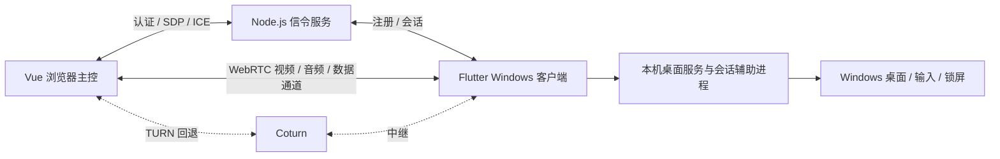

# 架构与代码来源

## 职责

- `src/`：控制页、连接状态、输入映射、工具面板与音频播放；`src/billd/` 为提取的上游块。
- `server/`：设备注册、认证、会话成员约束、信令转发、速率限制与静态文件。不会保存远程桌面画面或传输文件。
- `desktop/flutter/lib/ui/`：Windows 界面；`session/` 管理注册和媒体生命周期；`protocol/`、`tools/` 处理受限消息、文件和剪贴板。
- `native/windows/`：LocalSystem 服务、进程/管道身份校验、会话级辅助进程、桌面切换与 SendInput。
- `native/flutter/`：采集与系统音频桥接，以及 flutter-webrtc 的固定补丁。
- `electron-main/`：上游原生 IPC 的兼容测试适配，无 Electron 应用入口，不进入发行包。

正常桌面由原生 WebRTC 采集；桌面切换时使用辅助进程的帧源并替换同一 PeerConnection 的视频轨道。像素不通过 JavaScript/Dart JPEG 或 canvas 中转。安全桌面帧源目前最高 30 FPS。音频使用系统回环，默认关闭。

## 上游边界

| 来源 | 固定版本 | 用途 |
| --- | --- | --- |
| billd-desk | `61be620eb35b0004dc66c296f0fdd8c62700b1b9` | 56 段 WebRTC、输入、约束、状态代码 |
| billd-desk-server | `c73983e543341c08ce9e4fb7c52446be50b6c6a2` | 5 段信令枚举和转发函数 |
| Flutter / flutter-webrtc / libwebrtc | `native/flutter/dependencies.json` | 原生 Windows 客户端 |

`docs/upstream-*.json` 记录来源和哈希。`third_party/billd-*` 仅保留提取所需文件，不是完整可运行的上游项目。

UI、认证与生命周期边界、文件/剪贴板、Flutter 客户端、桌面服务和音频桥接是 WebDesk 实现。官方 BilldDesk 闭源客户端未被打包或复制，也不宣称性能和全部行为一致。

## 安全与性能边界

媒体优先点对点；网络不允许直连时使用 TURN。中继带宽会直接限制清晰度和帧率，服务器健康不等于链路性能足够。8K 是请求上限，实际分辨率受显示器尺寸和采集约束限制。

本机服务仅为已授权会话创建辅助进程，验证调用进程与管道身份；客户端退出时释放会话资源。密码不写入服务日志，客户端只持久化服务地址。浏览器重连过程中保留的凭据属于当前页面会话；不要共享仍有活动会话的浏览器配置。
