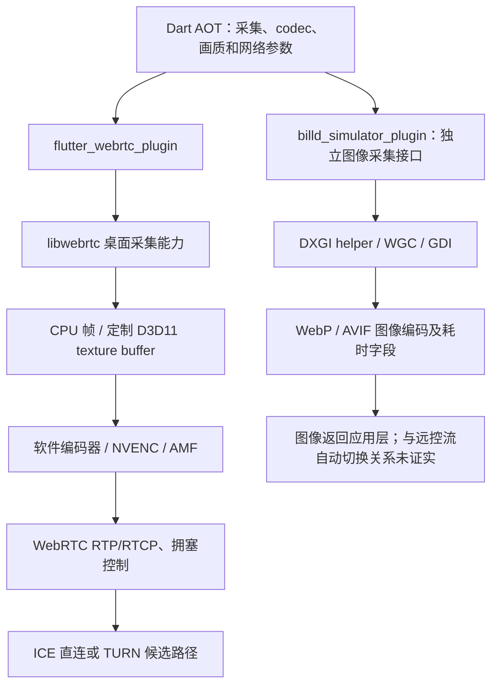

# BilldDesk 0.609.0 实际安装包：采集、编码、传输与降级

日期：2026-10-25。目标：用户指定的 `D:\BilldDesk`。本轮使用 REA 6.7.0 的原生制品检查和 GNU objdump 工作流，并用 PE 导入/导出、指令交叉引用和 Dart AOT 常量提取补齐证据。

本文中的 WebDesk 差距描述记录改造前基线；后续实现与实测见 [WebDesk 媒体改造记录](webdesk-media-alignment.md)。

**最值得用于 WebDesk 的方向是：按实际编码成本选择 codec、硬件编码及 GPU 纹理路径、分层且可恢复的降级，以及正常桌面采集的健康监测。** WebDesk 已有 DirectX→GDI、四帧池、基础自适应和可靠输入，重复添加这些功能的收益有限。

## 目标身份与方法

这是 **Flutter Windows 客户端 0.609.0+1**，构建路径包含 `billd-desk-flutter-pro`。上一份 Electron 固定源码分析不能代表此安装包。

| 制品 | 字节数 | SHA256 |
| --- | ---: | --- |
| `data/app.so` | 9,012,144 | `a33236647ebc61852fb517751d41dd3537d592b1b7c920e5f35de0327fe329fb` |
| `libwebrtc.dll` | 20,515,328 | `9d7933cc2eefe111502e7ef5aef23a07a943209590ffb781d3f494149d7392c1` |
| `flutter_webrtc_plugin.dll` | 498,176 | `f1f0e5fe955913e6488646e90e190de41afccede3ab3e79dfcd1c1c05c9bfa3e` |
| `billd_simulator_plugin.dll` | 506,880 | `76e2574bddb1cc89a42edf5b2eaeb463fa289bea5bfe753d0715059481c8dae3` |

`app.so` 是携带 Windows x64 Dart AOT 快照的 ELF64 容器。其 ELF 格式不代表安装包是 Linux 程序。VM/isolate 中的快照版本 hash 为 `1ce86630892e2dca9a8543fdb8ed8e22`；本轮未据此猜测 Flutter SDK 语义版本。

证据分为三类：**已观察的制品/指令**、**嵌入的设置/日志常量**、**由二者推导的设计建议**。未启动目标客户端、接入远程设备或测量会话性能；默认配置、实际协商 codec、硬编是否启用、零拷贝是否贯通及降级是否触发均没有运行验证。

REA 6.7.0 的 Dart 专用工具接受 APK，目录制品入口也不接受这种 Windows 安装目录，因此没有将 Windows 文件伪装为 APK。REA 成功取得 PE 资源、PE/ELF 文件与段头、符号检查及完整插件反汇编。额外使用项目内 pefile 2024.8.26、Capstone 5.0.6 静态核对调用点；Dart 字符串提取检查了快照对象头和 Smi 长度，不是完整 AOT 反编译。

## 媒体链路



图中列出包内可成立的结构和能力，不表示某次会话同时执行了所有分支。RTP/ICE 链路由 WebRTC 接口、引擎和参数共同佐证，没有抓包验证实际走 UDP、TCP 或 TURN。

### 屏幕采集：至少两套入口

**WebRTC 入口**：AOT 保留 `getDisplayMedia`；`flutter_webrtc_plugin.dll` 的 RVA `0x40f40` 例程读取 `network_mode`，在 `0x417a4` 调用 `LibWebRTC::SetScreenShareNetworkMode`，随后进入 desktop capturer 创建/启动逻辑。`libwebrtc.dll` 同时包含 GDI、WGC、DXGI 相关实现及定制 `api/video/d3d11_texture_buffer.cc` 路径。具体默认后端和当次会话的选择未确定。

**图像采集入口**：`billd_simulator_plugin.dll` 的 RVA `0x134d0` 例程可恢复出具体模式分派：

| 原生 capture mode 值 | 调用路径 | 指令证据 |
| --- | --- | --- |
| 1、2 | 独立 helper 例程 | `0x13963–0x139a3` → `0x29c00` |
| 3 | WGC 例程 | `0x139a5–0x139c8` → `0x2ad90`，有 StartCapture 与 D3D11 设备逻辑 |
| 其他值 | GDI 例程 | 跳转至 `0x13567` → `0x2a150`，后者在 `0x2a3dc` 调用 BitBlt |

模式 1/2 共用 helper 路径，但把模式值传入 helper；helper 内分别存在 DXGI 和 GDI 输入桌面采集实现，不能把两个数字都直接命名为 DXGI。原生枚举不应未经核对就与 Dart 的模式名称逐一对应。

在正常模式分派之前，`0x13530–0x13581` 还有一个条件分支，日志明确称旧系统隐私屏场景强制退 GDI，并直接调用 GDI 例程。日志对应的原始源码变量名和完整 OS 判定尚未恢复。

图像采集结果携带 `captureTimeMs`、`encodeTimeMs`（字面量文件 offset `0x608a8`、`0x608b8`）。插件实际导入 WebPEncodeRGBA、avifEncoderWrite；AVIF 代码包含 aom/svt 编码器选择回退。这与 WebRTC 视频的 H.264/AV1 编码是不同层次，不能因目录内有 aom/SvtAv1Enc DLL 就判断实时 WebRTC 在使用它们。

### 编码：确有定制硬编和 GPU 纹理代码

这次比“包里有硬件编码字符串”更强的证据是：

1. Dart 包含硬编/硬解、编码零拷贝/解码零拷贝的独立参数。
2. 插件 RVA `0x25670` 例程读取这些字段，在 `0x25a6d–0x25ab1` 实际调用六个独立的 libwebrtc setter：两个 vendor preference、两个 acceleration disabled、两个 zero-copy disabled。
3. DLL 的 NVENC 实现包含驱动 API 加载、设备能力查询、D3D11 纹理注册、BGRA/NV12 GPU 转换、shared texture/keyed mutex 和动态码率重配代码。RVA `0x5642a0` 例程被 Encode 路径 `0x565e0d` 直接调用，错误分支引用纹理格式、共享句柄、GPU 转换及 NV12 copy 的专有日志。
4. 同时存在 AMF 编码器构造路径；例如 RVA `0x56a090`、`0x571140`、`0x577dc0` 分别关联 H.264、AV1、H.265 AMF 编码器常量。

因此可以确认包内有定制硬件编码/纹理处理能力，但不能保证当前显卡、显示器所在适配器、接收端和某次 codec 协商能让整条路径生效。“零拷贝”还需区分 GPU 内复制、跨适配器复制与 CPU readback，不能理解成没有任何复制。微软的 [Desktop Duplication 文档](https://learn.microsoft.com/en-us/windows/win32/direct3ddxgi/desktop-dup-api)说明采集返回 DXGI surface，支持 GPU 处理；[NVENC 编程文档](https://docs.nvidia.com/video-technologies/video-codec-sdk/13.0/nvenc-video-encoder-api-prog-guide/index.html)说明了 DirectX 输入资源及编码能力查询方式。这支持优化路线，不证明 BilldDesk 本机已选中它。

**已确认的硬编回退**：NVENC InitEncode 的失败路径在 RVA `0x56595d` 调用 `0x565140`。后者有软件 H.264 编码器创建分支，实际调用 `0x750610`，并有其他 codec 类型不提供该软件回退的分支。不能外推为 H.265/AV1 在任何失败下都自动退成 H.264；改变 codec 通常还涉及协商，不能与同 codec 的实现切换混为一谈。

### 传输：有独立的原生低延迟配置

AOT 有 `网络模式`（offset `0x1d8bb0`）、`低延迟`（`0x201e00`）、`network_mode`（`0x22de80`）、`low_mode`（`0x255b00`）。

这里已恢复一段控制链：

```text
插件读取 network_mode
  → SetScreenShareNetworkMode（libwebrtc RVA 0x2310）
  → 将输入与 low_mode 比较
  → setter 0x3bd030 写入进程全局模式标记 RVA 0x133f0cc
  → getter 0x3bd050 被多个媒体/拥塞控制例程读取
```

交叉引用涉及：

- GoogCC `probe_controller.cc`，例如 RVA `0x9cbe00`、`0x9ccce0`、`0x9cd090`。
- `aimd_rate_control.cc`，RVA `0xb15760`。
- `trendline_estimator.cc`，RVA `0xb84c40`、`0xb852a0`。
- 视频发送/接收队列相关例程。

例如 `0xb84c91` 调 getter，低延迟分支再读取参数表覆盖构造值；probe 相关例程也按该模式读取另一组参数。这证明它不是单纯 UI 标签或 maxBitrate 设置。参数表字段语义、全部算法差异和弱网收益尚未完整恢复，不能直接照抄阈值。

**应警惕照搬全局开关**：这里的模式标记是进程全局变量；多个会话共存时，应核对各自设置如何相互影响。WebDesk 若引入类似模式，应优先采用会话级配置，明确共享采集源的策略，而非复制一个全局布尔值。

包内还保留强制中继/禁用中继、candidateType、relayProtocol、onSelectedCandidatePairChanged 等参数/统计词汇。这只能支持可配置和可观测的 ICE 路径，不能证明已经恢复“UDP 失败自动转 TCP/TURN”的状态机。

## “降级”应分层理解

| 层次 | 此包的证据 | 已知边界 |
| --- | --- | --- |
| 画质自适应 | 保帧率、保分辨率、平衡、禁用降级的专有中文说明；插件确有参数解析与 setter 调用 | 默认值与会话中实际选择未知 |
| 编码实现 | NVENC 初始化失败进入软件 H.264 分支 | 不等同于所有 codec 之间自动切换 |
| GPU 纹理路径 | 编码/解码零拷贝各自可禁用 | 自动禁用的触发条件、冷却与恢复未确认 |
| 采集兼容性 | 多后端分派及旧系统隐私屏强制 GDI 分支 | 不代表所有采集故障都自动按相同顺序回退 |
| 网络 | low_mode 影响原生媒体/拥塞控制；ICE policy 和候选统计 | 实际传输协议、失败重试与 TURN 切换未观测 |

画质模式可进一步核实到原生参数映射：插件 RVA `0x24540` 例程中，`maintain-framerate`→值 1，`maintain-resolution`→2，`balanced`→3，`maintain-framerate-and-resolution`/`disabled`→0，最后通过参数对象 setter 提交。AOT 对应说明分别是“牺牲分辨率”“牺牲帧率”和“不主动降分辨率和帧率，牺牲画质”。这已超过单纯枚举存在的证据，但仍未恢复 UI 事件的全部 AOT 调用链。

AOT 的另一条说明是“限定屏幕高度最大值是1080，以免分辨率过高导致编解码不过来，视频流空白”（offset `0x2471f0`）。它说明应用考虑了编解码预算，但不证明所有模式都强制 1080，也不应成为 WebDesk 一刀切的上限。

**不能混同的两个线索**：`RemoteWindow fallback stream create catch:` 只证明有 fallback stream 异常路径；屏幕墙则有独立的截图参数、上传接口和小于 50ms 不截图/不发送的节流说明。两者都没有足够证据证明“远控视频失败后自动改为 WebP/AVIF 传输”。

## 与 WebDesk 现状的差距

对照的是当前源码和实际构建工作区，不是 `.tools/libwebrtc-source` 未打补丁的基线，也未把 retired-hardware 的旧实现算作现状。

| WebDesk 当前能力 | 核对位置 |
| --- | --- |
| DirectX 捕获并退 GDI；四帧有界池、正确 stride、扣除采集耗时、screencast 标记 | `native/flutter/libwebrtc-desktop-capture.patch`；实际应用补丁见 `scripts/build-libwebrtc.ps1:93` |
| SinkWants 驱动降帧/缩放；motion/balanced/text 不同取舍 | 构建源码 `libwebrtc/src/internal/video_capturer.cc:26–54,111–131`；`desktop/flutter/lib/session/video_policy.dart:30–49` |
| Auto 码率按像素/fps 预算，限制 2–32Mbps | `video_policy.dart:8–20` |
| normal/secure 用 replaceTrack 切源；secure 是原始 BGRA 管道，没有当前链路的 JPEG 往返 | `remote_session.dart:143–221`；`native/windows/Worker.cs:91–115`；`native/flutter/secure_capture.h:51–84` |
| 可靠有序输入、move 合并/有界队列；ICE 候选缓存；文件传输背压 | `remote_session.dart:86–106,283–316`；`input_queue.dart:15–31`；`tool_channel.dart:48–58,311–337` |
| 编码器名、硬件标记、平均编码耗时、qualityLimit 统计 | `desktop/flutter/lib/session/media_stats.dart:19–43` |

因此不建议再把“加帧池”“改有序输入”“去掉 secure JPEG”“开启基础自适应”当成本次新优化。

## 可落实的优化顺序

这些是基于差距提出的工程方案，不是已经测得的性能提升。

### 第一批：让现有链路按真实成本工作

1. **修正固定 AV1 优先策略，加入编码成本和硬件能力决策。** 当前 `video_codecs.dart:8` 固定 AV1→VP9→VP8→H264，而当前 builtin factory 主要是软件编码实现。保留双方 capabilities，先观测实际 implementation、每帧编码耗时、qualityLimitationReason；当编码耗时持续超过目标帧预算时，降低采集负载或经过安全重协商选择更合适的 codec。60fps 的帧预算约 16.7ms，30fps 约 33.3ms，这是预算推导，不是 BilldDesk 已恢复的阈值。不要仅据 codec 名判断硬编，也不要强制所有设备使用 H.264。
2. **把采集后端与健康状态补入统计闭环。** WebDesk 已有编码统计，但 normal capture 缺少与 secure 类似的帧新鲜度检查；当前插件特意不绑定旧 observer，避免析构回调问题。应新增受生命周期保护的 native counters：实际 backend、最后成功帧时间、捕获/转换耗时、池满丢帧和重建原因。长期无帧时有界重建；GDI 稳定一段时间后试探恢复 DirectX，并有冷却。不要直接重新启用原先有析构风险的 observer。
3. **优化 secure 颜色转换。** 普通采集已调用 libyuv；`secure_capture.h:65–77` 仍是标量 BGRA→I420 2×2 循环。可复用 SIMD 转换，但需验证 BT.601 有限范围、U/V 采样、stride、奇数宽高及文字颜色。这里优化的是转换/复制，当前 secure 链路已不是 JPEG。

### 第二批：原生硬编与 GPU 帧传递

实现分为可独立回退的三层：**采集 backend → 帧内存/格式 → 编码实现**。

- 先实现并验证硬件 encoder factory，保留同 codec 软件后备。按设备/驱动/codec GUID 的实际能力排序，初始化失败时明确回退原因。
- 再提供 D3D11 texture buffer、GPU 缩放/颜色转换和硬编输入资源路径；保留 CPU I420 转换出口。纹理路径失败时允许只关闭零拷贝，继续硬编；硬编失败再转软件。
- 优先减少 4K→720p 的前段开销：当前普通桌面先按全屏采集并转 I420，再经 VideoAdapter/encoder 缩小。降低编码输出尺寸尚未消除全屏 CPU readback/转换成本。
- 比较同适配器和跨适配器的表现。键控互斥、共享纹理、缩放格式及驱动恢复是正确性要求，不能以“零拷贝”名称替代验证。
- H.265 与 AV1 的浏览器接收能力、profile 和实际实现均须协商核验。NVENC H.264 的同 codec 软件回退可独立做；H.265→H.264 是另一项协商改动。

这批比应用层调整复杂，潜在收益主要在高分辨率/高帧率 CPU 与端到端排队。尚无本机 A/B 数字，不能承诺提升倍数。

### 第三批：低延迟模式和故障恢复

先做可回退的应用层方案：基于 CPU/网络瓶颈分别调整采集预算和质量策略；限制排队；网络短暂中断后尝试有时限的 ICE restart，失败回收。当前主机注册重连不是媒体会话修复，浏览器的 disconnected 宽限也不是 ICE restart。

随后才试验原生 GoogCC/probe/AIMD 调参。BilldDesk 证明这种定制层存在，但没有证据证明其参数在 WebDesk 场景更优。不能因“低延迟”就关闭拥塞控制、锁定高码率或直接复制全局标记。WGC 也应作为有测量、有回退的采集候选，而非替换全部 DirectX/GDI 路径。

## 验证方案与待回答问题

建议按同机、同内容、同分辨率与同网络条件对照：1080p30/60、4K30/60，静态文字、滚动和视频动画；软件/硬编、CPU/GPU 帧路径、同/跨适配器；正常桌面、锁屏与切桌面；受控 RTT/丢包/带宽变化。

优先指标为捕获/转换/编码耗时的分位数、实际 fps、队列深度、丢帧原因、CPU/GPU、输出分辨率、实际编码器/候选路径，以及输入到画面的端到端延迟。先明确卡在捕获、编码、网络还是接收端解码，再决定回退哪一层。BilldDesk 的统计字段可借鉴，字段存在本身不代表产品已用它们自动闭环。

本轮仍未确认：应用远端下发的默认 RTC 配置、完整 Dart 调用图、运行时 codec/vendor/backend、所有回退触发条件和恢复时序，以及真实性能。也没有证据支持其使用自研远控 UDP、WebTransport 或 WebRTC 视频失败后改走截图通道。

## 可复核产物

最新补充解析已从 Dart AOT 执行指令恢复 `videoCodecs/videoCodecsSort` 的交集顺序及双向 SDP payload/RTX 处理；原生侧恢复了硬件能力过滤、供应商顺序和 selector 空值。它进一步解决了下文早期“仅常量”的边界，仍未证明按性能评分自动择优。见 [多编码复核与实现](webdesk-auto-codecs-20261025.md)及其三份证据 ledger。

后续针对首轮 VP8 的聚焦复核确认了 NVENC 初始化失败转同 H.264 软件路径，并定位到一条 High Profile 初始化路径；没有据此认定 BilldDesk 默认 codec。证据及已实施的 WebDesk 策略见 [H.264 策略修正](webdesk-h264-policy-20261025.md)和[原生聚焦记录](evidence/billd-nvenc-factory-focus-20261025.json)。本文前面的优化顺序是初次分析时的差距，当前实现以该后续记录及[媒体改造报告](webdesk-media-alignment.md)为准。

- [保留的媒体证据摘要](evidence/billd-desk-0.609.0-media.json)：版本、文件身份、7 份 REA Evidence 引用、48 个 Dart 常量、6 个原生模块的关键交叉引用及原生分支记录；不包含目标二进制。
- 完整 REA 输出、指令片段和补充解析脚本：`.tools/rea-billd-package/`。
- Dart 调查原始记录：`.tools/rea-billd-package/dart-investigation/`。

关键 REA Evidence：插件完整反汇编 `ev_188087ff2ca1ae75600030e560c032ca21eb346c079ca8f94d7560c5e51c6948`；libwebrtc 文件头 `ev_df9826857fcdf71faba9e07be8e651957accd96a24edc3c06618e1dfbc6fb6a7`；EXE 资源 `ev_adb9d3d8b9862ea3a8d9eb41d9ca735e3023e14a5a14390f3f627b041c771a1f`。插件反汇编输出完整，未截断。

Windows CLI 复核示例：

```powershell
$env:REA_OBJDUMP_COMMAND = 'D:\mingw64\bin\objdump.exe'
.\scripts\rea.ps1 inspect-with-objdump D:\BilldDesk\libwebrtc.dll file_headers --format json --full-output
.\scripts\rea.ps1 inspect-with-objdump D:\BilldDesk\flutter_webrtc_plugin.dll disassemble --format json --full-output
.\scripts\rea.ps1 inspect-pe-resources D:\BilldDesk\BilldDesk.exe --format json --full-output
```

本文 `RVA` 指 PE 映像相对地址，不是 ASLR 后的进程地址；Dart `offset` 指 app.so 文件字节位置。补充反汇编以 PE unwind 范围辅助定位，这些范围可能拆分源码函数；未将间接调用或缺失关系当作不存在。
