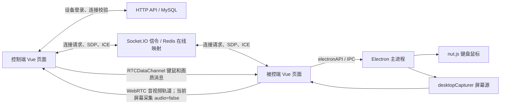

# billd-desk：REA 安装与静态逆向分析

分析日期：2026-10-25。REA 6.7.0 已安装、注册到 Codex，完成客户端、服务端及键盘 IPC 的静态证据提取。

用户提供的 `D:\BilldDesk` 实际是 Flutter 0.609.0+1，与本篇 Electron 源码版本不同；其媒体链路分析见 [实际安装包报告](billd-desk-installed-media-analysis.md)。

## 分析对象与结论边界

| 对象 | 固定提交 |
| --- | --- |
| billd-desk 客户端 | `61be620eb35b0004dc66c296f0fdd8c62700b1b9` |
| billd-desk-server | `c73983e543341c08ce9e4fb7c52446be50b6c6a2` |

先分析仓库 `third_party/` 中的精简快照，再从官方 GitHub 下载相同提交的完整源码至 `.tools/rea-targets/`，补齐认证和在线映射实现。没有将 WebDesk 后续适配器的行为归属于原版 billd-desk。

本轮回答了架构、连接认证、SDP/ICE、画面采集、画质设置及键鼠调用链。证据是静态源码和 REA AST 图；没有启动 billd-desk、连接线上服务、发送远控输入或验证漏洞利用。没有取得发布版 ASAR、安装器或 nut.js 原生二进制，因此发布包与这些源码的对应关系、原生实现、实际延迟和网络行为仍未验证。

## 已安装的工具

- REA：`.tools/rea/node_modules/rea-agents`，版本 **6.7.0**，来自官方 npm 包。
- 独立 Node：`.tools/rea-runtime/node-v24.11.0-win-x64/node.exe`；官方 ZIP 的 SHA256 已与 nodejs.org 的 `SHASUMS256.txt` 核对。未替换系统 Node。
- CLI 入口：`scripts/rea.ps1`，同时为 Windows 分析工作进程设置项目内临时目录。
- Codex MCP：`C:\Users\chrisdong\.codex\config.toml` 中的 `rea`；原配置备份为 `config.toml.rea.backup`。
- 配套工作流：`C:\Users\chrisdong\.agents\skills\reverse-engineer-anything`。

实际验证：CLI 返回 6.7.0；`doctor --client codex --skill` 返回 `healthy: true`；独立 MCP 客户端成功初始化并列出 **207 个工具**，包含 JavaScript 分析与 feature trace。当前聊天通过 CLI 使用同一分析能力；重新启动 Codex 后可加载新 MCP 注册。

```powershell
.\scripts\rea.ps1 --version
.\scripts\rea.ps1 doctor --client codex --skill --format json
node scripts/analyze-billd-rea.mjs
```

复现脚本要求上述固定提交的完整源码目录已存在。下载地址：

- [客户端源码 ZIP](https://codeload.github.com/galaxy-s10/billd-desk/zip/61be620eb35b0004dc66c296f0fdd8c62700b1b9)，SHA256 `516eb3edea440948edf03b4b40f5f7cf28b9351b43d6365fda78cb695285638c`。
- [服务端源码 ZIP](https://codeload.github.com/galaxy-s10/billd-desk-server/zip/c73983e543341c08ce9e4fb7c52446be50b6c6a2)，SHA256 `7d838d41ebcbba24f3c8fa8a60d6f87b429f62e6a3d3f0ac5ca837c5c5fe1e6b`。

工具缺失时，将官方 Node 24.11.0 Windows x64 ZIP 校验后解压至上述运行时目录，再执行 `npm install --prefix .tools/rea rea-agents@6.7.0 --ignore-scripts --no-audit --no-fund`。本轮 JavaScript 静态分析无需 Ghidra/Hopper；其他原生能力的可用性不由此次验证保证。安装说明见 [REA 官方仓库](https://github.com/morluto/rea)。

## 架构与数据流



远控媒体和输入主要走 WebRTC；Socket.IO 负责连接协调与信令。不能因存在 Socket.IO 就将其视为视频转发服务器。ICE 是否使用 TURN 以及最终是否直连，需要实际会话证据。

### 1. 设备身份与远控建立

被控页面创建或登录设备；控制前通过 HTTP `link_verify` 检查目标设备密码。Socket.IO 建连后发送 `billdDeskJoin`，包含设备 UUID、密码和房间号。控制窗口再发送 `billdDeskStartRemote`，携带双方设备凭据、目标房间及画质参数。

服务端 StartRemote 校验双方数据库密码，通过 Redis 查找被控端 socket，并返回 `billdDeskStartRemoteResult`。被控端收到成功结果后创建 RTC 并发出 offer。

证据：[客户端设备登录与控制入口](https://github.com/galaxy-s10/billd-desk/blob/61be620eb35b0004dc66c296f0fdd8c62700b1b9/src/views/remote/index.vue#L609)、[控制窗口连接请求](https://github.com/galaxy-s10/billd-desk/blob/61be620eb35b0004dc66c296f0fdd8c62700b1b9/src/views/webrtc/index.vue#L654)、[服务端 StartRemote](https://github.com/galaxy-s10/billd-desk-server/blob/c73983e543341c08ce9e4fb7c52446be50b6c6a2/src/config/websocket/handleMsg.ts#L707)。

### 2. Offer、answer 和 ICE

1. 被控端将采集轨道 `addTrack`，依次 `createOffer`、`setLocalDescription`，发送 `nativeWebRtcOffer`。
2. 控制端按 receiver 匹配消息，以 sender 建立 RTC；设置 remote description，创建并发送 `nativeWebRtcAnswer`。
3. 原 offer 端设置收到的 answer；双方通过 `nativeWebRtcCandidate` 交换 ICE。

信令外层是 `{requestId,msgType,data}`；offer 的 data 包含 `{isRemoteDesk,live_room,live_room_id,sender,receiver,sdp}`，candidate 包含 `{candidate,sender,receiver,live_room_id}`。服务器按客户端提交的房间广播，接收端再按 receiver 筛选。

证据：[RTC 协商封装](https://github.com/galaxy-s10/billd-desk/blob/61be620eb35b0004dc66c296f0fdd8c62700b1b9/src/hooks/webrtc/remoteDesk.ts#L73)、[客户端信令接收](https://github.com/galaxy-s10/billd-desk/blob/61be620eb35b0004dc66c296f0fdd8c62700b1b9/src/hooks/use-websocket.ts#L342)、[服务端转发](https://github.com/galaxy-s10/billd-desk-server/blob/c73983e543341c08ce9e4fb7c52446be50b6c6a2/src/config/websocket/index.ts#L421)。

### 3. 屏幕采集与画质

Electron 主进程通过 `desktopCapturer.getSources({types:['screen']})` 选首个屏幕源；renderer 使用 source ID 调 `getUserMedia`，此处明确 `audio:false`。视频约束以 height、frameRate 的 ideal 值提交；码率通过 RTCRtpSender `setParameters` 设置，输入单位 kbps，实际乘 1000 转 bps。

控制端动态设置通过 DataChannel 发送 `changeMaxBitrate`、`changeMaxFramerate`、`changeResolutionRatio` 和 contentHint 消息，被控端分别调用 setParameters、applyConstraints 或修改 contentHint。

证据：[屏幕源枚举](https://github.com/galaxy-s10/billd-desk/blob/61be620eb35b0004dc66c296f0fdd8c62700b1b9/electron-main/index.ts#L1092)、[采集与 RTC 初始化](https://github.com/galaxy-s10/billd-desk/blob/61be620eb35b0004dc66c296f0fdd8c62700b1b9/src/views/remote/index.vue#L704)、[动态设置接收](https://github.com/galaxy-s10/billd-desk/blob/61be620eb35b0004dc66c296f0fdd8c62700b1b9/src/views/remote/index.vue#L378)。

### 4. 键鼠到系统输入

完整链路：DOM key/mouse 事件 → NUT_KEY_MAP 与归一化坐标 → `billdDeskBehavior` JSON → RTCDataChannel → 被控 renderer `JSON.parse` → `handleRtcBilldDeskBehavior` → Electron IPC → nut.js。

行为 payload 使用 `{roomId,sender,receiver,type,key,x,y,amount}` 等字段；坐标按目标元素归一化到 0–1000。被控端用主屏尺寸、scaleFactor 换算成本机像素坐标，再调用 `mouse.move`、`keyboard.pressKey/releaseKey`、鼠标按下/释放等 API。IPC 产生自己的 requestId，回执没有沿原 DataChannel 请求返回。

证据：[控制端键盘入口](https://github.com/galaxy-s10/billd-desk/blob/61be620eb35b0004dc66c296f0fdd8c62700b1b9/src/views/webrtc/index.vue#L874)、[行为到 IPC 映射](https://github.com/galaxy-s10/billd-desk/blob/61be620eb35b0004dc66c296f0fdd8c62700b1b9/src/hooks/use-ipcRendererSend.ts#L200)、[系统键盘执行](https://github.com/galaxy-s10/billd-desk/blob/61be620eb35b0004dc66c296f0fdd8c62700b1b9/electron-main/index.ts#L720)。

## 具体发现

以下是固定提交的代码事实及其影响推断，尚未在运行中的目标上复现。

| 发现 | 证据与含义 |
| --- | --- |
| 输入通道允许乱序、丢失 | `webRTC.ts:558–565` 为 `ordered:false,maxRetransmits:3`。按下和释放没有应用层序号、ACK 或状态快照；乱序/丢失可能造成卡键。断开清理也未见释放已按下输入。 |
| 初始码率未必生效 | `remoteDesk.ts:45–48` 构造参数中 maxBitrate/maxFramerate/resolutionRatio 被注释；RTC maxBitrate 初始为 -1，connected 时仅非 -1 才设置。UI 默认的 2000 kbps 不能视为已经应用。 |
| 多连接画质作用域混用 | `remote/index.vue:378–407,744`：每个 item 的 channel 回调操作共享 `rtc.value`；该 ref 会被新连接覆盖。分辨率/帧率又作用于共享轨道，可能影响其他控制者。 |
| ICE 没有就绪前队列 | `use-websocket.ts:516–524` 直接查 RTC 并 addIceCandidate；找不到实例时不保留，remote description 未就绪失败时只日志。可能造成偶发协商失败。 |
| 协商失败被吞掉 | `webRTC.ts:207–241` 的多个 SDP/ICE helper 捕获错误但不重新抛出；调用者可能继续执行后续步骤。 |
| 多屏坐标可能不匹配 | 采集取首个枚举屏幕，而输入换算使用 primary display；多屏位置与缩放不一致时可能偏移。 |
| 设备路由身份缺少校验 | 服务端 `handleMsg.ts:663–705` 的 Join 仅检查 roomId 非空，直接加入房间并登记客户端 UUID；`:166–195` 的 UpdateUser 也未验证设备密码即可更新 UUID→socket 映射。StartRemote 的双密码校验不能代替这些入口的身份绑定。 |
| 信令未绑定已授权会话 | `index.ts:421–462` 的 offer/answer/ICE 入口按请求房间转发，未核对成功 StartRemote 会话、sender 与当前 socket 的对应关系或目标设备。实际可达影响需隔离复现。 |
| 远端密码字段进入连接结果 | `handleMsg.ts:815–834` 只过滤 `deskUserPassword`，保留 `remoteDeskUserPassword`，并向所选房间广播成功结果。已静态核对上游锁定的 billd-utils **0.0.22**：filterObj 排除指定键，其余字段原样保留；下载包 integrity 与上游 pnpm lock 一致。不能据此声称已窃取线上凭据。 |
| 设备密码以应用原值存取 | `deskUser.service.ts:85–95,129–131` 用 UUID/密码直接查询和 create；`deskUser.model.ts:19–45` 为普通 STRING，所查模型/服务未见散列机制。部署数据库的磁盘加密不在此次证据范围内。 |

相关源码：[DataChannel 设置](https://github.com/galaxy-s10/billd-desk/blob/61be620eb35b0004dc66c296f0fdd8c62700b1b9/src/utils/network/webRTC.ts#L558)、[Join](https://github.com/galaxy-s10/billd-desk-server/blob/c73983e543341c08ce9e4fb7c52446be50b6c6a2/src/config/websocket/handleMsg.ts#L663)、[在线映射更新](https://github.com/galaxy-s10/billd-desk-server/blob/c73983e543341c08ce9e4fb7c52446be50b6c6a2/src/config/websocket/handleMsg.ts#L166)、[连接结果](https://github.com/galaxy-s10/billd-desk-server/blob/c73983e543341c08ce9e4fb7c52446be50b6c6a2/src/config/websocket/handleMsg.ts#L815)、[设备密码查询](https://github.com/galaxy-s10/billd-desk-server/blob/c73983e543341c08ce9e4fb7c52446be50b6c6a2/src/service/deskUser.service.ts#L85)。

修复方向由上述边界推导：将设备身份、房间、sender 和一次授权会话绑定；广播结果剔除双方密码；输入事件使用可靠有序通道或序号/状态同步，断开时释放输入；对 ICE 排队并传播 SDP 错误；将每连接画质状态与共享采集轨道的策略明确分开。这些是分析建议，本轮没有修改产品代码。

## REA 证据与覆盖范围

输出保存在 `.tools/rea-analysis/`，未加入版本控制；报告与复现入口保留在仓库。

| 文件 | 内容 |
| --- | --- |
| `summary.json` | 两次深入分析与键盘 trace 的摘要、SHA256、统计和限制 |
| `billd-desk.json` / `billd-desk-server.json` | 最初两份本地精简快照的完整 Evidence |
| `billd-desk-derived.json` | 17 个选定客户端输入，16 个 TS/JS 文件成功解析，包含两份 Vue script 派生文件 |
| `billd-desk-server-focused.json` | 完整服务端的 7 个选定输入，6 个 TS 文件成功解析，包含 Join/StartRemote/设备登录实现 |
| `derived-provenance.json` | 原始文件哈希、派生路径及变换说明；Vue script 保留原始行号 |
| `keyboard-trace.json` | 从 keyboardPressKey IPC handler 向入边追踪的结果 |
| `setup-result.json` / `doctor.json` / `mcp-smoke.json` | 安装与 MCP 初始化验证结果 |

核心 Evidence ID：

- 原始客户端快照：`ev_2ad1125373836aa0454f929cf26a4991945af2f2885a8c475857055264cf037c`。
- 客户端派生输入：`ev_44d97572bfb88b9d263390a691c734bf857f48fb9f402ca7df6d97e47a6a7bed`。
- 完整服务端选定文件：`ev_2c30cd7058fc0262067b20251dae9bd028bc07c5d7be9ecf3880a8a3bc735902`。
- 键盘 IPC trace：`ev_4d0cd59b50572cd1afc0763e8e5f8899182de678227d9f60aba6c6bb5f3cc4aa`。

REA 观察到 37 个主进程 IPC handler、2 个 BrowserWindow 和 1 个 contextBridge API。37 个 channel 都是 `IPC_EVENT.xxx` 表达式，工具没有解析为可精确配对的字面量通道；不能将配对数为 0 解释为没有 renderer 调用。它也没有证明 nut.js 的原生导出不存在。

派生输入的摘要不能冒充原始发布包摘要。客户端语义覆盖状态为 `unknown`，含 5302 个 unknown 记录；服务端为 `partial`，含 3936 个 unknown 记录；这些记录不是漏洞计数。键盘 trace 匹配 1 个 seed，返回 4 个节点、3 条边，覆盖为 partial；完整键鼠链由源码逐层核对补齐，并非工具自动恢复了跨网络、跨进程的全部调用。

重复运行脚本会产生新的派生目录与 Evidence；以最新 summary 和 provenance 中的身份为准。生产部署的实际版本、TLS、代理限流、房间可达性，以及发布包对原生依赖的修改，均需要后续针对具体制品或隔离运行环境的证据。
