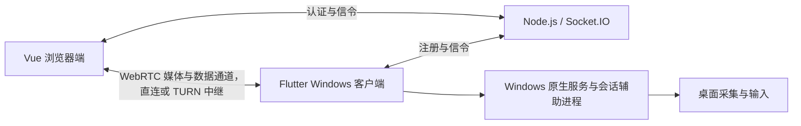

# 开发指南

适用版本：0.5.8。本文说明代码结构、本地开发、测试和构建；服务器部署见[自部署指南](self-hosting.md)。

## 架构与来源

WebDesk 由浏览器主控端、Windows 被控客户端和信令服务组成。



| 目录 | 职责 |
| --- | --- |
| `src/` | 浏览器界面、WebRTC 连接、远程输入、文件与剪贴板 |
| `server/` | 设备注册、会话认证、信令转发和网页静态资源 |
| `shared/` | 通用协议定义与传输限制 |
| `desktop/flutter/` | Windows 界面、托盘、会话及媒体资源管理 |
| `native/windows/` | LocalSystem 服务、进程身份校验、命名管道、桌面切换与输入 |
| `native/flutter/` | 原生采集、系统声音桥接、依赖清单与补丁 |
| `third_party/` | 上游源码、来源清单与许可证 |
| `scripts/`、`tests/` | 构建、校验和测试 |
| `build/inno/`、`deploy/` | Windows 安装器与服务器部署配置 |

视频、音频、文件和剪贴板通过 WebRTC 传输，信令服务不接收这些内容。正常桌面使用原生 WebRTC 采集；安全桌面使用辅助进程提供的 BGRA 帧，在客户端转换为 I420。系统声音由独立的 WASAPI loopback 采集，默认关闭，不采集麦克风。

当前功能边界：

- 采集首个枚举显示器，未提供显示器选择界面。
- 最高画质档请求 4320p；实际分辨率和帧率受显示器、编码能力及网络影响。安全桌面采集最高 30 FPS。
- 工具通道使用 WebDesk tools v2，单个文件上限为 2 GiB。网页、服务端和客户端应同步更新。
- 锁屏和安全桌面控制依赖已安装的原生服务，仍需通过 Windows 登录认证。

上游代码来源见 [billd-desk 清单](../third_party/billd-desk/manifest.json)、[billd-desk-server 清单](../third_party/billd-desk-server/manifest.json)和[原生依赖清单](../native/flutter/dependencies.json)。托盘插件保存在 `third_party/tray_manager/`，来源与修改范围记录于其 `upstream.json`。`electron-main/` 仅用于兼容测试，不属于发行客户端。许可证见[第三方声明](../THIRD_PARTY_NOTICES.md)，权限边界见[安全策略](../SECURITY.md)。

### 键鼠输入

网页通过 `src/core/controller-input.ts` 统一处理输入，使用可靠有序的数据通道发送。鼠标左右键和中键发送成对的按下/松开事件，双击由 Windows 根据两组事件识别；浏览器的 `click`、`dblclick` 和 `contextmenu` 不额外生成点击。按钮和滚轮操作前同步位置，拖出画面时将坐标限制在视频边界。

Windows 客户端串行处理输入，只合并相邻的鼠标移动，不跨越按键或按钮事件。页面隐藏、失焦、退出控制或连接关闭时释放输入状态。

键盘按物理键位传输，字符由远端布局和输入法决定。网页全屏时，`Esc` 退出全屏并释放本地键盘焦点；非全屏且视频获得焦点时，`Esc` 正常传给远端。浏览器或操作系统保留的快捷键、鼠标侧键、本地输入法的组合文本和 `Ctrl+Alt+Delete` 安全注意序列不在支持范围内。中文可使用远端输入法或文本剪贴板。

## 开发环境

| 开发范围 | 环境要求 |
| --- | --- |
| 网页与服务端 | Node.js 22、npm、Git |
| Windows 客户端 | Windows x64、Visual Studio 2022 C++ 桌面开发工具、Windows SDK 10.0.26100.0、.NET Framework 编译器 |
| 安装包 | 上述环境及 Inno Setup 6.7.3 |

Flutter、flutter-webrtc 和 libwebrtc 使用依赖清单固定的版本。准备脚本将 SDK 和构建缓存放在 `.tools/`，将 flutter-webrtc 检出到被 Git 忽略的 `third_party/flutter-webrtc/`。

以下命令均从仓库根目录执行，注明工作目录的命令除外。

### 网页与服务端

```sh
npm ci
```

复制 `.env.example` 为 `.env`，在两个终端分别启动：

```sh
npm run server
npm run dev
```

浏览器访问 `http://127.0.0.1:5173`；开发服务器将 `/socket.io` 代理到 `127.0.0.1:4300`。Windows 客户端服务地址填写 `http://127.0.0.1:4300`。环境变量说明见[自部署指南](self-hosting.md#服务配置)。

`npm run preview:ui` 可启动模拟界面预览，不建立真实远程连接。

### Windows 客户端

在 Windows PowerShell 中执行：

```powershell
npm run prepare:flutter
npm run dev:host
```

准备脚本下载固定依赖、应用原生补丁并配置插件目录联接。专用 libwebrtc 使用无硬件输入的音频模块，由独立系统声音源提供音频；构建过程会校验配方与二进制哈希。首次源码编译需要较多下载、磁盘空间和时间，后续构建复用通过校验的缓存。

仅运行 Dart 分析和单元测试时，可用下列命令代替完整准备：

```powershell
.\scripts\prepare-flutter.ps1 -SkipAudioBuild
```

此选项不准备可发布的原生音频库。开发程序也不能直接复用绑定到其他客户端路径的已安装桌面服务。

## 测试与验收

### 自动检查

```sh
npm test
npm run release:check
```

`npm test` 先校验上游提取代码、执行 TypeScript 检查并构建网页，再运行 Node 测试。`release:check` 检查客户端、服务端和锁文件的版本一致性。

完成依赖准备后，在 Windows PowerShell 中运行 Flutter 检查：

```powershell
$env:PUB_CACHE = Join-Path $PWD '.tools\pub-cache'
Push-Location desktop\flutter
try {
    ..\..\.tools\flutter\bin\flutter.bat analyze --no-pub
    ..\..\.tools\flutter\bin\flutter.bat test --no-pub
} finally {
    Pop-Location
}
```

原生回归测试：

| 命令 | 检查内容 |
| --- | --- |
| `.\scripts\test-flutter-task-runner.ps1` | 消息分发、并发任务、标题栏按钮与取消操作 |
| `.\scripts\test-tray.ps1` | 托盘菜单失焦关闭、重复打开、命令选择及主窗口保持隐藏 |
| `.\scripts\test-audio.ps1` | 系统声音启停、断开清理及麦克风会话释放 |

音频测试需先完成完整原生依赖准备，并在有可用音频设备的 Windows 实机运行；测试会播放短暂测试音。自动化检查不能替代实际 Explorer 托盘面板和远程会话验收。

### 发布验收

使用两台设备验证以下流程，并记录环境、结果和异常：

- 安装、升级、卸载；开启、停止和重新连接远程会话。
- 键鼠、画质切换、双向文件传输和文本剪贴板。
- 声音开关、断开后的音频释放，以及被控端本地音量与麦克风占用。
- 最小化、关闭到托盘、恢复窗口；菜单外点击、Esc 取消、菜单打开与退出。
- UAC、锁屏、解锁和睡眠恢复；直连与 TURN 中继下的连通性。

性能结果需注明分辨率、帧率、连接路径及 CPU/GPU 占用。`scripts/test-flutter-elevated.ps1` 是专用服务联调入口，需提前准备测试程序和本地控制端，并以管理员身份运行；它会临时更改服务绑定并在结束时恢复。锁屏测试需有人在场解锁。

## 构建与发布

### Windows 安装包

```powershell
.\scripts\setup-inno.ps1
npm run build:inno
```

构建会运行版本校验、原生回归、Flutter 分析和测试，使用生产入口 `lib/main.dart` 编译，并校验依赖、管理员清单和音频库。输出位于 `flutter-release/0.5.8/`：

- `WebDesk-0.5.8-win-x64.exe`：安装包。
- `WebDesk-0.5.8-win-x64.exe.sha256`：校验文件。
- `build.json`：构建信息及对应 payload 目录。

构建命令不安装应用。`npm run build:flutter` 仅生成程序目录；`npm run preview:installer` 预览安装界面。代码签名需由发行者配置。

### 服务端包

```sh
npm run package:server
```

输出为 `server-release/webdesk-<随机后缀>.tar.gz` 及同名 `.sha256` 文件，部署步骤见[自部署指南](self-hosting.md)。

### 维护规则

- 发布版本同步修改根目录和 `deploy/runtime/` 下的 `package.json`、`package-lock.json`，以及 `desktop/flutter/pubspec.yaml`；Flutter build number 随发布增加。
- 上游生成代码通过提取脚本维护，使用 `npm run upstream:check` 校验；原生插件修改保存为 `native/flutter/` 中的补丁，托盘插件修改保存在仓库内的源码中。
- 会话拥有其创建的连接、媒体、输入和工具资源；关闭流程禁止新操作，并在单项释放失败时继续清理其他资源。
- 提交依赖变更时同步锁文件、来源清单和许可证，不提交 SDK、缓存、测试产物或个人配置。

Linux CI 检查网页和协议并生成服务端包；Windows PR 检查 Flutter 和原生回归。Windows 安装包工作流在 `main` 分支匹配的文件变更或手动触发时运行。工作流上传构建产物，不自动发布 Release 或部署服务器。
